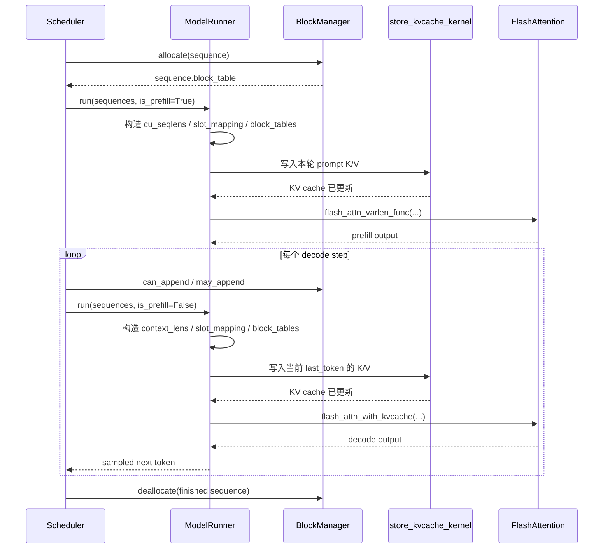

# Nano-vLLM Paged Attention 源码分析

本文分析 Nano-vLLM 中 paged attention 的数据结构、地址映射、KV cache 生命周期和
attention kernel 执行过程。项目没有自行实现完整的 paged-attention 计算 kernel：

- KV cache 写入由项目内的 Triton kernel 实现。
- Prefill attention 使用 `flash_attn_varlen_func`。
- Decode paged attention 使用 `flash_attn_with_kvcache`。
- 逻辑页分配、页表构造和物理 slot 计算由 Nano-vLLM 自己实现。

项目通过 [`pyproject.toml`](../pyproject.toml) 依赖 `flash-attn` 和 `triton`。本文中的
attention kernel 示例是与项目布局对应的教学性参考实现，用于解释算法，不是第三方库
源码的复制，也没有替换生产 kernel。

## 1. Paged Attention 解决的问题

标准自回归生成需要为每条序列保存每层 attention 的 K 和 V。假设：

- batch size 为 $B$
- 最大上下文长度为 $L_{\max}$
- KV head 数量为 $H_{kv}$
- head dimension 为 $D$

如果为每条请求预留一个连续的最大长度 tensor，单层 KV cache 的元素数量是：

$$
2 \times B \times L_{\max} \times H_{kv} \times D
$$

这里的 2 分别代表 K 和 V。这种方式有三个问题：

1. 请求长度差异会造成大量预留空间浪费。
2. 请求增长时可能需要重新分配或搬移连续内存。
3. 请求结束留下的空洞难以立即被其他请求利用。

Paged attention 借用了虚拟内存分页思想：

- 将每条序列的逻辑 token 空间切分成固定大小的逻辑 block。
- 在全局 KV cache 中预分配固定大小的物理 block。
- 每条序列通过 block table 将逻辑 block 映射到任意物理 block。
- attention kernel 根据 block table 间接寻址 K/V。

这样，序列不需要占用连续物理显存，只需随着长度增长逐块申请空间。

## 2. Nano-vLLM 的整体结构

```text
Sequence.token_ids
       |
       | 按 block_size 切分
       v
Sequence.block_table                  例：[7, 2, 18]
       |
       | ModelRunner 构造 GPU tensor
       v
block_tables[batch, max_num_blocks]
       |
       +---------------------+
       |                     |
       v                     v
slot_mapping[token]      paged attention kernel
写入新 K/V               读取历史 K/V
       |                     |
       v                     v
全局 KV cache[physical_block, block_offset, kv_head, head_dim]
```

对应源码：

- [`Sequence`](../nanovllm/engine/sequence.py)：保存每条序列的 `block_table`。
- [`BlockManager`](../nanovllm/engine/block_manager.py)：分配和回收物理 block。
- [`ModelRunner`](../nanovllm/engine/model_runner.py)：创建 KV cache，构造
  `slot_mapping`、`context_lens` 和 `block_tables`。
- [`Context`](../nanovllm/utils/context.py)：把本轮 attention 元数据传递给各层。
- [`Attention`](../nanovllm/layers/attention.py)：写入 K/V，并调用 FlashAttention。

## 3. KV Cache 的物理布局

KV cache 在
[`ModelRunner.allocate_kv_cache()`](../nanovllm/engine/model_runner.py)
中一次性分配：

```python
self.kv_cache = torch.empty(
    2,
    num_hidden_layers,
    num_kvcache_blocks,
    block_size,
    num_kv_heads,
    head_dim,
)
```

各维度含义如下：

| 维度 | 含义 |
|---|---|
| `2` | K cache 和 V cache |
| `num_hidden_layers` | Transformer 层数 |
| `num_kvcache_blocks` | GPU 上可用的物理 block 数 |
| `block_size` | 每个 block 容纳的 token 数 |
| `num_kv_heads` | 当前 tensor-parallel rank 的 KV head 数 |
| `head_dim` | 每个 attention head 的维度 |

每个 attention 层得到两个 view：

```python
module.k_cache = self.kv_cache[0, layer_id]
module.v_cache = self.kv_cache[1, layer_id]
```

所以在单层内部，逻辑形状为：

```text
k_cache[num_physical_blocks, block_size, num_kv_heads, head_dim]
v_cache[num_physical_blocks, block_size, num_kv_heads, head_dim]
```

### 3.1 单个物理 block 的显存开销

项目用下面的公式估算一个物理 block 在所有层上的开销：

```python
block_bytes = (
    2
    * num_hidden_layers
    * block_size
    * num_kv_heads
    * head_dim
    * dtype.itemsize
)
```

可分配 block 数是：

```python
num_kvcache_blocks = available_cache_bytes // block_bytes
```

因此，以下因素都会线性增加 KV cache 开销：

- Transformer 层数。
- block size。
- KV head 数量。
- head dimension。
- dtype 字节数。

GQA/MQA 通过减少 `num_kv_heads` 降低 KV cache 开销，从而允许保存更多并发序列。

## 4. 逻辑 Block 和物理 Block

[`Sequence`](../nanovllm/engine/sequence.py) 用下面的公式计算逻辑 block 数：

```python
num_blocks = (num_tokens + block_size - 1) // block_size
```

一条序列的 `block_table` 保存逻辑 block 到物理 block 的映射。例如
`block_size = 4`：

```text
序列 token:
  t0 t1 t2 t3 | t4 t5 t6 t7 | t8 t9

逻辑 block:
      0       |      1       |   2

block_table:
     [7,             2,          18]
```

物理 KV cache 中的布局可以完全不连续：

```text
physical block 2  <- logical block 1
physical block 7  <- logical block 0
physical block 18 <- logical block 2
```

给定序列内 token 位置 `token_pos`，其地址计算公式为：

```text
logical_block = token_pos // block_size
block_offset  = token_pos % block_size
physical_block = block_table[logical_block]

physical_slot = physical_block * block_size + block_offset
```

恢复完整多维地址后：

```text
K[physical_block, block_offset, kv_head, dim]
V[physical_block, block_offset, kv_head, dim]
```

这是 paged attention 最核心的间接寻址过程。

## 5. BlockManager：物理页管理

[`BlockManager`](../nanovllm/engine/block_manager.py) 维护：

```python
self.free_block_ids = deque(range(num_blocks))
self.used_block_ids = set()
self.blocks = [Block(i) for i in range(num_blocks)]
```

每个 `Block` 包含：

- `block_id`：物理 block 编号。
- `ref_count`：引用该 block 的序列数量。
- `hash`：prefix cache 使用的链式 hash。
- `token_ids`：用于验证 hash 命中的实际 token。

### 5.1 分配

`BlockManager.allocate()` 首先复用命中的 prefix blocks，然后为剩余逻辑 blocks
从 `free_block_ids` 分配物理 block：

```python
seq.block_table.append(self._allocate_block())
```

分配结果只修改页表，不需要搬移其他序列已经写入的 KV cache。

### 5.2 增长

decode 每生成一个 token，序列可能跨入新的逻辑 block。`may_append()` 在需要时追加
一个物理 block：

```python
if len(seq) % self.block_size == 1:
    seq.block_table.append(self._allocate_block())
```

这里调度发生在当前 `last_token` 执行 attention 之前。当 `len(seq) % block_size == 1`
时，当前 token 正是新逻辑 block 的第一个 token，因此需要先为它准备物理 block。

### 5.3 回收

序列结束或被抢占时，`deallocate()` 递减所有 block 的引用计数。引用计数归零后，
物理 block 返回 free list：

```python
block.ref_count -= 1
if block.ref_count == 0:
    self._deallocate_block(block_id)
```

引用计数允许多个具有相同前缀的序列共享完整的 prefix blocks。

## 6. Block Table 的 Batch 表示

不同序列拥有不同数量的逻辑 blocks。`ModelRunner.prepare_block_tables()` 将页表
padding 成二维 tensor：

```python
max_len = max(len(seq.block_table) for seq in seqs)
block_tables = [
    seq.block_table + [-1] * (max_len - len(seq.block_table))
    for seq in seqs
]
```

例如：

```text
sequence A: [7, 2, 18]
sequence B: [5]
sequence C: [11, 9]

block_tables:
[
  [ 7,  2, 18],
  [ 5, -1, -1],
  [11,  9, -1],
]
```

`-1` 只是 padding。kernel 必须结合 `context_lens` 计算每条序列的有效逻辑 block
范围，不能访问 padding 对应的页。

## 7. Slot Mapping：新 K/V 写到哪里

`block_tables` 用于读取一条序列的全部历史 K/V，`slot_mapping` 则描述本轮每个输入
token 产生的新 K/V 应写入哪个物理 slot。

### 7.1 Prefill

[`ModelRunner.prepare_prefill()`](../nanovllm/engine/model_runner.py) 对每条序列
计算：

```python
start = seq.num_cached_tokens
end = start + seq.num_scheduled_tokens
```

只为 `[start, end)` 范围内本轮真正计算的 token 生成 slot。对每个覆盖到的逻辑
block：

```python
slot_start = seq.block_table[i] * block_size
slot_start += start % block_size       # 首 block 的局部偏移

slot_end = seq.block_table[i] * block_size + ...
slot_mapping.extend(range(slot_start, slot_end))
```

假设：

```text
block_size = 4
block_table = [7, 2, 18]
本轮计算 token position [3, 8)
```

则：

```text
position 3 -> block 7, offset 3 -> slot 31
position 4 -> block 2, offset 0 -> slot 8
position 5 -> block 2, offset 1 -> slot 9
position 6 -> block 2, offset 2 -> slot 10
position 7 -> block 2, offset 3 -> slot 11

slot_mapping = [31, 8, 9, 10, 11]
```

### 7.2 Decode

decode 时每条序列只有一个输入 token，因此：

```python
slot = (
    seq.block_table[-1] * block_size
    + seq.last_block_num_tokens
    - 1
)
```

这里输入 token 是 `seq.last_token`。本轮 attention 首先把它产生的 K/V 写入该 slot，
再读取包含它在内的完整上下文，最后采样出下一个 token。

## 8. 项目内的 KV Cache 写入 Kernel

Nano-vLLM 自己实现了
[`store_kvcache_kernel`](../nanovllm/layers/attention.py)：

```python
@triton.jit
def store_kvcache_kernel(
    key_ptr,
    key_stride,
    value_ptr,
    value_stride,
    k_cache_ptr,
    v_cache_ptr,
    slot_mapping_ptr,
    D: tl.constexpr,
):
    idx = tl.program_id(0)
    slot = tl.load(slot_mapping_ptr + idx)
    if slot == -1:
        return

    key_offsets = idx * key_stride + tl.arange(0, D)
    value_offsets = idx * value_stride + tl.arange(0, D)
    key = tl.load(key_ptr + key_offsets)
    value = tl.load(value_ptr + value_offsets)

    cache_offsets = slot * D + tl.arange(0, D)
    tl.store(k_cache_ptr + cache_offsets, key)
    tl.store(v_cache_ptr + cache_offsets, value)
```

launch grid 是 `(N,)`，即每个输入 token 对应一个 Triton program：

```python
store_kvcache_kernel[(N,)](...)
```

其中：

```text
N = 本轮参与计算的 token 总数
D = num_kv_heads * head_dim
```

kernel 将：

```text
k[idx, :, :] -> k_cache[slot_mapping[idx], :, :]
v[idx, :, :] -> v_cache[slot_mapping[idx], :, :]
```

从逻辑多维视角看，`slot` 已经合并了：

```text
physical_block * block_size + block_offset
```

而 `D` 合并了：

```text
kv_head * head_dim + dim
```

所以写入地址可以表达为：

```text
cache_address =
    ((physical_block * block_size + block_offset)
     * num_kv_heads + kv_head)
    * head_dim + dim
```

### 8.1 为什么写入 kernel 不需要 block table

block table 到物理地址的转换已经由 CPU 侧的 `prepare_prefill()` 或
`prepare_decode()` 完成，kernel 直接消费扁平的 `slot_mapping`。这样写入 kernel：

- 不需要知道请求属于哪个 sequence。
- 不需要重复执行整除和页表查询。
- 对 prefill 和 decode 使用相同的实现。

### 8.2 内存访问特征

每个 program 顺序读取一个 token 的全部 K/V heads，并写入一个连续物理 slot。
`head_dim` 是最内层连续维度，项目还通过 stride assertion 保证布局符合预期：

```python
assert key.stride(-1) == 1
assert key.stride(1) == head_dim
assert k_cache.stride(1) == D
```

这使同一个 program 内相邻 lane 可以访问相邻地址，形成合并访存。

## 9. Prefill Attention

[`Attention.forward()`](../nanovllm/layers/attention.py) 首先把本轮产生的 K/V
写入全局 cache，然后根据 `context.is_prefill` 选择 kernel。

没有 prefix cache 时：

```python
flash_attn_varlen_func(
    q,
    k,
    v,
    cu_seqlens_q=...,
    cu_seqlens_k=...,
    max_seqlen_q=...,
    max_seqlen_k=...,
    causal=True,
)
```

多个变长序列被压平到一个 token 维度：

```text
q = [seq0 tokens][seq1 tokens][seq2 tokens]...
```

`cu_seqlens_q` 和 `cu_seqlens_k` 是累积长度。例如序列长度为 `[3, 5, 2]`：

```text
cu_seqlens = [0, 3, 8, 10]
```

kernel 根据相邻元素确定每条序列的起止位置，不需要把它们 padding 到相同长度。

### 9.1 Prefix Cache 命中时

如果 `cu_seqlens_k[-1] > cu_seqlens_q[-1]`，说明 K/V 上下文包含未出现在本轮 Q
中的缓存前缀。此时 `ModelRunner` 会设置 `block_tables`，attention 层改用全局 cache：

```python
if context.block_tables is not None:
    k, v = k_cache, v_cache
```

于是：

- Q 只包含本轮新计算的 token。
- K/V 包含缓存前缀加本轮新写入内容。
- `block_table` 告诉 kernel 如何读取该序列的完整 K/V。

## 10. Decode Paged Attention

decode 路径调用：

```python
flash_attn_with_kvcache(
    q.unsqueeze(1),
    k_cache,
    v_cache,
    cache_seqlens=context.context_lens,
    block_table=context.block_tables,
    softmax_scale=self.scale,
    causal=True,
)
```

输入的概念形状为：

```text
q:            [batch, 1, num_query_heads, head_dim]
k_cache:      [num_blocks, block_size, num_kv_heads, head_dim]
v_cache:      [num_blocks, block_size, num_kv_heads, head_dim]
context_lens: [batch]
block_table:  [batch, max_num_logical_blocks]
```

对于 batch 中第 `b` 条序列、第 `qh` 个 query head，attention 数学表达式仍然是：

$$
S_i = \frac{Q_{b,qh} K_{b,kvh,i}^{T}}{\sqrt{D}}
$$

$$
P_i = \frac{\exp(S_i)}{\sum_j \exp(S_j)}
$$

$$
O_{b,qh} = \sum_i P_i V_{b,kvh,i}
$$

差别只在于 $K_i$ 和 $V_i$ 不位于一块连续的序列内存中，而是通过页表读取。

### 10.1 GQA 的 Head 映射

当 query head 数多于 KV head 数时，多个 query heads 共享同一组 K/V。常见映射为：

```text
queries_per_kv_head = num_query_heads // num_kv_heads
kv_head = query_head // queries_per_kv_head
```

例如 32 个 query heads、8 个 KV heads：

```text
query heads 0..3   -> KV head 0
query heads 4..7   -> KV head 1
...
query heads 28..31 -> KV head 7
```

这不会改变分页方式，但会显著降低每个 block 保存 K/V 的数据量。

## 11. 教学版 Paged Attention Kernel

下面是与 Nano-vLLM 张量布局对应的伪代码。它刻意省略生产 kernel 中的向量化、
warp 分工、双缓冲和硬件特化，以突出分页寻址：

```python
for sequence b in batch:
    context_len = context_lens[b]

    for query_head qh in range(num_query_heads):
        kvh = qh // queries_per_kv_head
        q = Q[b, 0, qh, :]

        scores = []
        values = []

        for token_pos in range(context_len):
            logical_block = token_pos // block_size
            block_offset = token_pos % block_size
            physical_block = block_tables[b, logical_block]

            k = K_cache[physical_block, block_offset, kvh, :]
            v = V_cache[physical_block, block_offset, kvh, :]

            scores.append(dot(q, k) * softmax_scale)
            values.append(v)

        probabilities = softmax(scores)
        output[b, 0, qh, :] = sum(
            probabilities[i] * values[i]
            for i in range(context_len)
        )
```

真实 GPU kernel 不会先保存完整 `scores` 和 `values`，因为这会产生额外的
$O(L)$ 中间显存访问。它通常使用 tiled computation 和 online softmax。

## 12. Online Softmax

Paged attention kernel 可以按 block 或 tile 流式扫描上下文。对于当前已处理部分，
维护三个状态：

- `m`：已见 score 的最大值。
- `l`：以 `m` 为基准的指数和。
- `acc`：以相同基准加权累积的 V。

初始值：

```text
m = -infinity
l = 0
acc = 0
```

读取一个新的 score tile 后：

```text
tile_max = max(scores)
new_m = max(m, tile_max)

old_scale = exp(m - new_m)
tile_probs = exp(scores - new_m)

new_l = old_scale * l + sum(tile_probs)
new_acc = old_scale * acc + sum(tile_probs[:, None] * values)

m = new_m
l = new_l
acc = new_acc
```

最终：

```text
output = acc / l
```

这个算法具有两个重要性质：

1. 数值稳定，不直接计算可能溢出的 `exp(score)`。
2. 不需要把完整 attention score matrix 写入显存。

### 12.1 Triton 风格参考骨架

下面的代码仅用于展示 kernel 的索引和 online-softmax 结构，不是可直接替换
FlashAttention 的完整实现：

```python
@triton.jit
def paged_decode_attention_reference(
    q_ptr,
    k_cache_ptr,
    v_cache_ptr,
    block_tables_ptr,
    context_lens_ptr,
    out_ptr,
    stride_q_batch,
    stride_q_head,
    stride_cache_block,
    stride_cache_token,
    stride_cache_head,
    stride_table_batch,
    stride_out_batch,
    stride_out_head,
    NUM_Q_HEADS: tl.constexpr,
    NUM_KV_HEADS: tl.constexpr,
    HEAD_DIM: tl.constexpr,
    BLOCK_SIZE: tl.constexpr,
    TOKENS_PER_TILE: tl.constexpr,
    SCALE: tl.constexpr,
):
    batch_id = tl.program_id(0)
    query_head = tl.program_id(1)
    kv_head = query_head // (NUM_Q_HEADS // NUM_KV_HEADS)

    dims = tl.arange(0, HEAD_DIM)
    q = tl.load(
        q_ptr
        + batch_id * stride_q_batch
        + query_head * stride_q_head
        + dims
    )

    context_len = tl.load(context_lens_ptr + batch_id)
    m = -float("inf")
    l = 0.0
    acc = tl.zeros((HEAD_DIM,), dtype=tl.float32)

    for token_start in range(0, context_len, TOKENS_PER_TILE):
        token_pos = token_start + tl.arange(0, TOKENS_PER_TILE)
        valid = token_pos < context_len

        logical_block = token_pos // BLOCK_SIZE
        block_offset = token_pos % BLOCK_SIZE
        physical_block = tl.load(
            block_tables_ptr
            + batch_id * stride_table_batch
            + logical_block,
            mask=valid,
            other=0,
        )

        # 实际 kernel 会构造二维 tile，并以向量化方式加载 K/V。
        k = load_k_tile(
            k_cache_ptr,
            physical_block,
            block_offset,
            kv_head,
            dims,
        )
        v = load_v_tile(
            v_cache_ptr,
            physical_block,
            block_offset,
            kv_head,
            dims,
        )

        scores = tl.sum(k * q[None, :], axis=1) * SCALE
        scores = tl.where(valid, scores, -float("inf"))

        tile_max = tl.max(scores, axis=0)
        new_m = tl.maximum(m, tile_max)
        old_scale = tl.exp(m - new_m)
        probs = tl.exp(scores - new_m)

        acc = acc * old_scale + tl.sum(probs[:, None] * v, axis=0)
        l = l * old_scale + tl.sum(probs, axis=0)
        m = new_m

    output = acc / l
    tl.store(
        out_ptr
        + batch_id * stride_out_batch
        + query_head * stride_out_head
        + dims,
        output,
    )
```

生产级实现通常还会处理：

- `HEAD_DIM` 不是 2 的幂时的 mask。
- 不同 dtype 的加载、累积和输出转换。
- 一个 head 由多个 warps/CTAs 并行扫描长上下文。
- 分段结果的归并。
- shared memory/register 使用量控制。
- Tensor Core 或专用矩阵指令。
- 不同 GPU 架构和 head size 的特化。
- CUDA graph 下固定容量 batch 的无效槽位。

## 13. 为什么 Decode Kernel 是 Memory-Bound

decode 时每个 sequence 只有一个 query token，但必须读取全部历史 K/V：

```text
Q 读取量：O(num_query_heads * head_dim)
KV 读取量：O(context_len * num_kv_heads * head_dim)
计算量：  O(context_len * num_query_heads * head_dim)
```

单 token decode 的矩阵尺寸较小，K/V 读取占比很高，因此通常受显存带宽和访存效率
限制。Paged attention 带来了额外的 block-table 间接寻址，但避免了更昂贵的：

- 大量预留浪费。
- KV cache 搬移。
- 对不同上下文长度进行大面积 padding。

实现上的主要优化方向包括：

1. 让同一个物理 block 的 K/V 尽量被连续读取。
2. 在 query heads 之间复用 GQA 共享的 K/V。
3. 用 online softmax 避免 score matrix 回写显存。
4. 合理选择 block size，平衡内部碎片和页表开销。
5. 对当前 GPU、head dimension 和 dtype 选择合适的 tile/warp 配置。

## 14. Block Size 的权衡

较大的 block：

- 页表更短。
- block-table 查询次数更少。
- 连续访问范围更大。
- 但序列最后一个未填满 block 的内部碎片更大。
- 分配粒度更粗，低显存时更容易因为缺少整个 block 而抢占。

较小的 block：

- 内部碎片更小。
- 分配和回收更细粒度。
- 但页表更长，管理和间接寻址开销更高。

Nano-vLLM 默认 `kvcache_block_size = 256`，并要求它是 256 的倍数。这个选择简化了
实现，但不是所有模型、上下文长度或 GPU 上的通用最优值。

## 15. Prefix Cache 如何共享物理页

`BlockManager.hash_blocks()` 为完整逻辑 block 计算链式 hash。后一个 block 的 hash
包含前一个 block 的 hash，因此只有从序列起点开始完全相同的 token 前缀才能命中。

命中时：

```python
block.ref_count += 1
seq.block_table.append(block_id)
```

多条序列可以让自己的逻辑 block 指向同一个物理 prefix block：

```text
Sequence A block_table: [7, 2, 18]
Sequence B block_table: [7, 2, 23]
                          ^  ^
                          共享前缀
```

只有完整 block 会被 hash 和共享，最后一个可能继续增长的不完整 block 不参与命中，
从而避免两个序列在同一个可变 block 中相互覆盖。

## 16. Prefill、Decode 与 Cache 的完整时序



关键顺序是：

1. 为当前 token 准备物理 block。
2. 根据 block table 计算 slot mapping。
3. 运行模型得到当前 token 的 Q/K/V。
4. 将当前 token 的 K/V 写入 cache。
5. attention 读取包括当前 token 在内的完整上下文。
6. 根据输出 logits 采样下一个 token。
7. 下一轮再为这个新 token 计算和写入 K/V。

## 17. Context 元数据

[`Context`](../nanovllm/utils/context.py) 是模型外部调度信息与 attention 层之间的
桥梁：

| 字段 | Prefill | Decode | 用途 |
|---|---|---|---|
| `is_prefill` | `True` | `False` | 选择 attention 路径 |
| `cu_seqlens_q` | 使用 | 不使用 | 变长 Q 的序列边界 |
| `cu_seqlens_k` | 使用 | 不使用 | 变长 K 的序列边界 |
| `max_seqlen_q` | 使用 | 不使用 | kernel launch 上界 |
| `max_seqlen_k` | 使用 | 不使用 | kernel launch 上界 |
| `slot_mapping` | 使用 | 使用 | 新 K/V 的物理写入位置 |
| `context_lens` | 不使用 | 使用 | 每条序列的有效上下文长度 |
| `block_tables` | prefix 命中时 | 使用 | 逻辑页到物理页映射 |

`ModelRunner.run()` 在每轮结束后调用 `reset_context()`，避免下一轮复用旧元数据。

## 18. CUDA Graph 下的 Paged Attention

decode 可以使用预捕获的 CUDA graph。实际 batch size 可能小于捕获容量，因此
`ModelRunner.run_model()` 会：

```python
graph_vars["slot_mapping"].fill_(-1)
graph_vars["slot_mapping"][:bs] = context.slot_mapping

graph_vars["context_lens"].zero_()
graph_vars["context_lens"][:bs] = context.context_lens
```

无效 batch 槽位具有：

- `slot_mapping = -1`：KV 写入 kernel 直接返回。
- `context_len = 0`：attention kernel 不应读取任何有效 K/V。

项目内 `store_kvcache_kernel` 明确检查了 `slot == -1`。这允许用较大的固定 graph
batch 容量执行较小的真实 batch。

## 19. 正确性约束和边界条件

实现 paged attention 时必须保持以下不变量：

### 19.1 页表容量

对任意有效 token position：

```text
token_pos // block_size < len(sequence.block_table)
```

因此 decode 前必须先执行 `may_append()`，不能等 KV 写入时才分配。

### 19.2 Slot 与输入 token 一一对应

项目检查：

```python
assert slot_mapping.numel() == N
```

其中 `N` 是本轮 K/V tensor 的 token 数。如果二者不一致，会把 K/V 写入错误请求的
cache，造成跨请求污染。

### 19.3 Context length 不能超过已分配容量

每条序列应满足：

```text
context_len <= len(block_table) * block_size
```

kernel 只应遍历 `[0, context_len)`，不能根据 padding 后的 block-table 宽度推断长度。

### 19.4 Prefix block 只读共享

被多个序列引用的 prefix block 不应再被追加写入。项目只缓存完整 block，并为后续
token 使用新的 block，从设计上避免 copy-on-write 问题。

### 19.5 Tensor Parallel 一致性

每个 tensor-parallel rank 只保存自己的 KV heads：

```text
local_num_kv_heads = total_num_kv_heads / tensor_parallel_size
```

所有 rank 的 block 分配顺序和 `block_table` 必须一致，否则不同 rank 会为同一逻辑
token 访问不同物理位置。

## 20. 当前实现与完整生产实现的边界

Nano-vLLM 已经包含 paged attention 的关键机制：

- 全局分块 KV cache。
- 每序列 block table。
- 动态 block 分配和回收。
- slot mapping。
- 变长 prefill。
- paged decode。
- prefix block 共享。
- KV cache 不足时的 recompute preemption。

为了保持代码精简，它把最复杂的 GPU attention kernel 委托给 `flash-attn`，并且没有
覆盖一些大型 serving 系统常见的能力：

- KV cache CPU swap。
- 跨 GPU 的 KV cache 分层管理。
- 异构 block size。
- KV cache quantization。
- 滑动窗口或稀疏 attention 的专用页管理。
- prefill 和 decode 混合在同一次 forward 的统一 kernel。
- 面向多租户的 cache 隔离和配额。

## 21. 总结

Nano-vLLM 的 paged attention 可以分为三个层次：

1. **页管理层**  
   `BlockManager` 将序列的逻辑 token blocks 映射到全局物理 KV blocks，并负责
   分配、引用计数、prefix 共享和回收。

2. **元数据准备层**  
   `ModelRunner` 把每条序列的 `block_table` 转换成 GPU tensor，并计算
   `slot_mapping`、`context_lens` 和变长序列边界。

3. **GPU kernel 层**  
   项目内 Triton kernel 根据 `slot_mapping` 写入新 K/V；FlashAttention kernel
   根据 `block_table` 和 `context_lens` 间接读取历史 K/V，并通过 tiled attention
   和 online softmax 计算输出。

Paged attention 没有改变 attention 的数学定义。它改变的是 K/V 的存储、分配和寻址
方式：用页表间接寻址换取低碎片、免搬移、动态增长和高效的多请求共享，从而成为
continuous batching 能够在有限显存中维持大量不同长度请求的基础。
